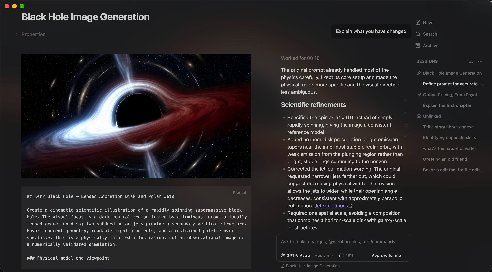
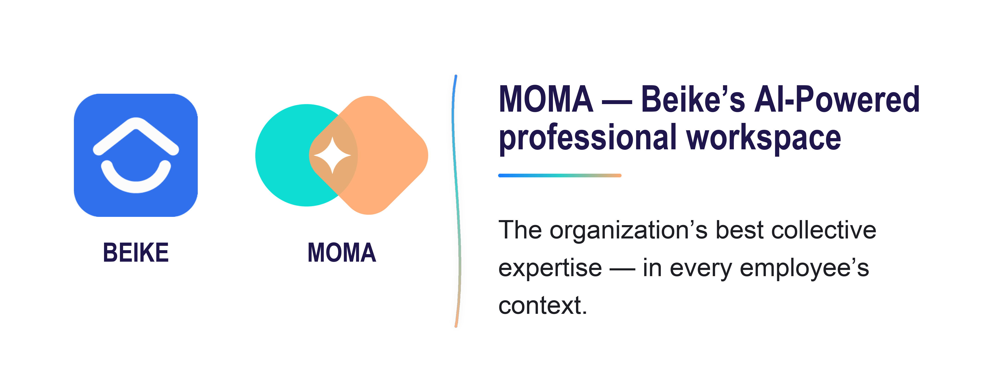

# KK-Nerodian

Claudian 2.3.43 기반의 별도 Obsidian 플러그인입니다. 데스크톱의 기존 화면과
처리 구조를 유지하면서 Codex와 Claude Code의 SSH 원격 실행을 추가했습니다.
모바일에는 KK-Hermes-Connect의 입력창·대화 선택·메시지 표시를 재사용한
채팅 화면을 제공하며, 인증 브리지로 Codex/Claude Code에 연결합니다.

- 플러그인 ID: `KK-Nerodian`, 버전: `0.1.0`
- 설정과 대화 메타데이터: `.kk-nerodian/` (기존 `.claudian/`과 분리)
- 기존 Claudian과 동시에 설치할 수 있습니다.

## 데스크톱 SSH 연결

1. KK-Nerodian 설정 → 제공자 → Codex 또는 Claude Code → **SSH 원격 연결**로 이동합니다.
2. 호스트(`user@host` 또는 SSH config 별칭), 원격 작업 폴더의 절대 경로,
   원격 실행 파일(`codex` 또는 `claude`), 필요하면 개인 키와 포트를 입력합니다.
3. 터미널에서 먼저 해당 서버의 호스트 키를 확인하고 키 인증을 설정합니다.
   원격 서버에서 해당 제공자의 로그인도 완료합니다.
4. **SSH 연결 검사**를 누른 뒤 **SSH로 원격 실행**을 켭니다.
5. 기존 Claudian 화면에서 모델을 새로고침하고 대화를 시작합니다.

SSH 설정의 **SSH 가져오기 / 내보내기** 버튼에서 JSON 파일 선택 또는
붙여넣기로 연결 정보를 가져올 수 있습니다. **Hermes 파일 불러오기**는 현재
볼트 루트의 `kk-hermes-environment.private.json`을 읽으며, **설정 가져오기**를
누르면 Tailscale 주소·Ubuntu 계정·원격 볼트 경로를 현재 제공자에 적용합니다.
원격 실행 파일은 현재 탭에 따라 `codex` 또는 `claude`로 설정합니다.
Hermes 가져오기 후에는 연결 검사를 거쳐 SSH 실행을 켜세요.

**JSON 내보내기**는 볼트 루트에 `kk-nerodian-codex-ssh.private.json` 또는
`kk-nerodian-claude-ssh.private.json`을 저장합니다. 해당 제공자 탭에서 다시
가져올 수 있으며, 비밀번호·토큰·개인 키 내용은 포함하지 않습니다.
Hermes의 HTTPS 주소와 인증은 Hermes 브리지 전용이며, 모바일 KK-Nerodian에는
별도로 Nerodian 브리지 주소와 토큰을 설정해야 합니다.

원격 서버의 작업 폴더에 파일이 있어야 합니다. SSH가 로컬 볼트를 자동으로
복사하거나 동기화하지 않습니다. 다른 제공자는 기존 로컬 설정을 사용합니다.
지원 대상은 POSIX 셸, OpenSSH, `find`, `base64`를 갖춘 Linux/macOS 서버입니다.

## 모바일 연결

1. 서버에 아래 브리지를 실행합니다. 사용할 Codex/Claude 로그인과 작업 폴더가 필요합니다.
2. Tailscale Serve 등으로 브리지를 HTTPS로 연결합니다. 휴대폰도 같은 tailnet에 연결합니다.
3. [GitHub 릴리즈](https://github.com/Nero-kk/KK-Nerodian/releases)에서 `main.js`, `manifest.json`, `styles.css`를 각각 내려받아 휴대폰 볼트의 `.obsidian/plugins/KK-Nerodian/`에 저장하고 플러그인을 켭니다.
4. **원격 연결 설정**에 HTTPS 주소와 접속 토큰을 저장합니다.
5. 네트워크 모양 리본 아이콘 또는 **원격 채팅 열기** 명령을 사용합니다.

모바일의 기본 제공자는 Codex입니다. 제공자를 바꾸면 새 대화를 생성합니다.
모델 칸을 비우면 서버 설정의 기본 모델을 사용하며, 모델 ID를 직접 지정할 수도 있습니다.

토큰은 각 기기의 Obsidian 비밀 저장소에 저장합니다. 서버는 인증 없는 요청과
브라우저 Origin 요청을 거부합니다. 도구 실행은 채팅 안에서 승인하거나 거부할 수
있으며, 앱을 닫았다가 다시 연결해도 서버의 진행 상태와 대화를 가져옵니다.
데스크톱에서도 같은 원격 채팅 명령을 사용할 수 있습니다.

## 브리지 실행

GitHub 릴리즈에서 브리지의 `server.mjs`, `package.json`, `.env.example`을 각각 내려받아 서버의 빈 디렉터리에 저장합니다. Node.js 24 이상이 필요합니다.

```bash
npm install --omit=dev
cp .env.example .env
node -e "console.log(require('node:crypto').randomBytes(32).toString('hex'))"
```

생성한 값을 `.env`의 `NERODIAN_TOKEN`으로 넣고 `NERODIAN_WORKSPACE`,
`NERODIAN_CODEX_PATH`와 `NERODIAN_CLAUDE_PATH`를 실제 서버 경로로 변경한 뒤 `npm start`를 실행합니다.
브리지는 기본적으로 `127.0.0.1:17868`에서만 수신합니다.
SSH로 다른 서버의 제공자를 실행하려면 `.env.example`의 `NERODIAN_SSH_*`를 설정합니다.

```bash
tailscale serve --bg --set-path=/nerodian http://127.0.0.1:17868
```

이 경우 모바일 주소는 `https://서버이름.tailnet.ts.net/nerodian`입니다.
운영 시에는 systemd 등으로 브리지를 관리합니다. 접속 토큰과 `.env`는 배포 파일이나
공유 볼트에 포함하지 마세요.

## 개발 및 원본

Node.js 버전은 `.node-version`을 따릅니다.

```bash
npm ci --ignore-scripts
npm run typecheck
npm run lint
npm test -- --maxWorkers=4
npm run build
npm run build:bridge
```

원본: YishenTu/claudian 태그 `2.3.43`, 커밋 `147eb35`.
MIT 라이선스와 원저작자 표기를 유지합니다. 아래는 원본 Claudian 문서입니다.

---

<p>
  <a href="https://trendshift.io/repositories/21115?utm_source=repository-badge&amp;utm_medium=badge&amp;utm_campaign=badge-repository-21115">
    
  </a>
  
  <a href="https://community.obsidian.md/plugins/realclaudian">
    
  </a>
  
  
  <br clear="both">
</p>



An Obsidian plugin that embeds AI coding agents (Claude Code, Codex, Grok Build, Antigravity CLI, OpenCode, Pi, DeepSeek Harness, and more to come) in your vault. Your vault becomes the agent's working directory — file read/write, search, bash, and multi-step workflows all work out of the box.

## Features & Usage

Open Claudian interface from the ribbon icon or command palette. Everything works like your familiar coding agent, Claude Code, Codex, Grok Build, Antigravity CLI, OpenCode, Pi, and DeepSeek Harness — talk to the agent, and it reads, writes, edits, searches and run commands in your vault.

**Inline Edit** — Select text or start at the cursor position + hotkey to edit directly in notes with word-level diff preview.

**Projects** — Group sessions that work toward a shared goal. Every member shares the project's instructions and a memory file that the agents keep current, and the agents can cooperate by finding, reading and messaging each other. See the [Projects guide](docs/projects.md).

**Zen Mode** — Collapse the sidebar holding Claudian and the chat moves to a [compact composer](assets/zen-mode-collapsed.png) at the bottom of your notes, with a one-line activity preview and [the conversation one click away](assets/zen-mode-expanded.png).

**Slash Commands & Skills** — Type `/` or `$` for reusable prompt templates or Skills from user- and vault-level scopes.

**@mention** — Type `@` to reference vault files, folders and other Claudian sessions.

**Cross-Session Messaging** — Let agents read, message, steer or interrupt other Claudian sessions, or start new ones on any provider. See the [Cross-session messaging guide](docs/cross-session-messaging.md).

**Side Chat (`/side` or `/btw`)** — Explore a separate, temporary conversation with follow-ups and tools while keeping the main chat unchanged.

**MCP Servers** — Connect external tools through each coding agent's native CLI-managed MCP configuration.

**Tabs & Session Management** — Use multiple tabs in [single-pane mode](assets/main-chat-single-pane.png) or a persistent session manager beside the chat in [dual-pane mode](assets/main-chat-dual-pane.png).

**Plugin API (experimental)** — Let other Obsidian plugins send prompts to sessions, stop them and read their replies. See the [Plugin API guide](docs/plugin-api.md).

**Collaboration** — Collab is now a standalone plugin. See [Claudian Collab](https://github.com/YishenTu/claudian-collab).

## Requirements

- At least one of the following harnesses:
  - [Antigravity CLI](https://antigravity.google/product/antigravity-cli)
  - [Claude Code](https://code.claude.com/docs/en/overview)
  - [Codex](https://github.com/openai/codex)
  - [DeepSeek Harness](https://github.com/deepseek-ai/deepseek-harness)
  - [Grok Build](https://github.com/xai-org/grok-build)
  - [OpenCode V2](https://github.com/anomalyco/opencode)
  - [Pi](https://github.com/earendil-works/pi)
- A compatible subscription or API provider
- Obsidian v1.13.0+
- Desktop only (macOS, Linux, Windows)

## Installation

### From Obsidian Community Plugins (recommended)

1. Open Obsidian → Settings → Community plugins → Browse
2. Search for "Claudian" and click Install
3. Enable the plugin

Or install directly from the [community plugin page](https://community.obsidian.md/plugins/realclaudian).

### From source (development)

1. Clone this repository into your vault's plugins folder:
   ```bash
   cd /path/to/vault/.obsidian/plugins
   git clone https://github.com/YishenTu/claudian.git realclaudian
   cd realclaudian
   ```

2. Install dependencies and build:
   ```bash
   npm install
   npm run build
   ```

3. Enable the plugin in Obsidian:
   - Settings → Community plugins → Enable "Claudian"

### Development

```bash
# Watch mode
npm run dev

# Production build
npm run build
```

## Privacy & Data Use

- **Sent to API**: Your input, attached files, images, and tool call outputs. Depending on the selected provider, data is sent to Anthropic (Claude), OpenAI (Codex), xAI (Grok), Google (Antigravity), or the providers configured in OpenCode, Pi, or DeepSeek Harness. The destination can be configured through provider settings and environment variables.
- **No telemetry or unsolicited background activity**: Claudian does not run telemetry beacons. UI polling timers read local Obsidian/editor selection state only. Network activity is limited to explicit provider runtime work, configured MCP endpoints, a 127.0.0.1-only listener that OpenCode, DeepSeek and Grok sessions use for Claudian's session tools, provider SDK/CLI calls needed to answer your requests, and their configured services.

## Troubleshooting

See the [Troubleshooting guide](docs/troubleshooting.md) for a provider CLI or Node.js that isn't found, a newly released model that is missing, and authentication that fails while the CLI subscription works. If you have a feature request or run into a bug, please [submit a GitHub issue](https://github.com/YishenTu/claudian/issues).

## Architecture

```
src/
├── main.ts                      # Plugin entry point and sole composition root
├── composition/                 # Host objects and view wiring shared by app and features
├── app/                         # Startup, conversations, settings, and storage
├── core/                        # Provider-neutral execution, registry, and type contracts
│   ├── execution/               # Run, session snapshot, and interaction primitives
│   ├── providers/               # Provider registry and workspace services
│   ├── process/                 # CLI discovery and managed child processes
│   ├── prompt/                  # Prompt and context encoding
│   ├── auxiliary/               # Shared provider auxiliary services
│   └── ...                      # bootstrap, commands, rpc, security, storage, tools, types
├── providers/
│   ├── antigravity/             # Antigravity CLI ACP adaptor, transcript history, models
│   ├── claude/                  # Claude Agent SDK adaptor, native history, plugins
│   ├── codex/                   # Codex shared app-server adaptor, JSON-RPC, JSONL history
│   ├── deepseek/                # DeepSeek Harness native Remote adaptor, presets, and history
│   ├── grok/                    # Grok Build ACP adaptor, native history, models, and tools
│   ├── opencode/                # OpenCode HTTP adaptor, shared server
│   ├── pi/                      # Pi RPC adaptor, model discovery, JSONL history
│   └── acp/                     # Agent Client Protocol shared mechanics
├── features/
│   ├── agent-skills/            # Vault skill and Claude command management
│   ├── chat/                    # Sidebar chat: tabs, workspace lifecycle, controllers, renderers
│   ├── inline-edit/             # Inline edit modal and provider-backed edit services
│   └── settings/                # Settings shell and provider tabs
├── shared/                      # Reusable UI components, settings controls, mention/dropdown
├── i18n/                        # Internationalization (10 locales)
├── utils/                       # Domain-free leaf helpers
└── style/                       # Modular CSS
```

## Contributing

Issues and focused pull requests are welcome. Issues are the preferred starting point: describe the problem, reproduction steps, and environment clearly so it can be investigated.

Before opening a pull request, please read the [contribution guide](CONTRIBUTING.md). Pull requests must explain the problem, the proposed solution, why the approach is appropriate, and how the change was validated. Pull requests that add a new provider are not accepted; the guide explains this maintenance and product-quality boundary in detail.

## Star History

<a href="https://www.star-history.com/?repos=YishenTu%2Fclaudian&type=date&legend=top-left">
 <picture>
   <source media="(prefers-color-scheme: dark)" srcset="https://api.star-history.com/chart?repos=YishenTu/claudian&type=date&theme=dark&legend=top-left&sealed_token=UAS9n3qO4GyhCCkOr9kcAl7msVtDEz-DoQTkpFuPrAELxMEK9PQWj9zG566afbx0CkF5OoIbLRkxiDIoMRCK5Q-HXbLUiimg1lT8wKDdcc_eP48_EodHFrR6UtY8jS7Mzik4lLd_sY8oVj2I42lISFB1tSlr4gnXwOCNwtTn6iQakbru7yKPIO3uVYpP" />
   <source media="(prefers-color-scheme: light)" srcset="https://api.star-history.com/chart?repos=YishenTu/claudian&type=date&legend=top-left&sealed_token=UAS9n3qO4GyhCCkOr9kcAl7msVtDEz-DoQTkpFuPrAELxMEK9PQWj9zG566afbx0CkF5OoIbLRkxiDIoMRCK5Q-HXbLUiimg1lT8wKDdcc_eP48_EodHFrR6UtY8jS7Mzik4lLd_sY8oVj2I42lISFB1tSlr4gnXwOCNwtTn6iQakbru7yKPIO3uVYpP" />
   
 </picture>
</a>

## Sponsorship

### Kimi (Moonshot AI)


Thanks Kimi (Moonshot AI) for supporting Claudian! Try a **Kimi Code plan** ([CN](https://www.kimi.com/code?aff=claudian) | [Global](https://www.kimi.ai/code?aff=claudian)), or use the **API** through the Kimi Open Platform ([CN](https://platform.kimi.com?track_id=track-8415973bd2f5424dadf3cee1cdbacaca&aff=claudian) | [Global](https://platform.kimi.ai?track_id=track-39fcfe097e114d8b8ca8fbcd1abf7266&aff=claudian)). New users receive bonus API credits equal to 10% of their first successful top-up. This offer ends December 31, 2026. Claudian receives no affiliate commission from these links.

### Ke Holdings Inc. (BEIKE)



Claudian is proudly sponsored by Ke Holdings Inc. (BEIKE) and the MOMA team. Their support helps Claudian continue to improve through ongoing development and maintenance.

> Want to support Claudian or appear here? Contact me: [tysk01213@gmail.com](mailto:tysk01213@gmail.com).

## License

Licensed under the [MIT License](LICENSE).
